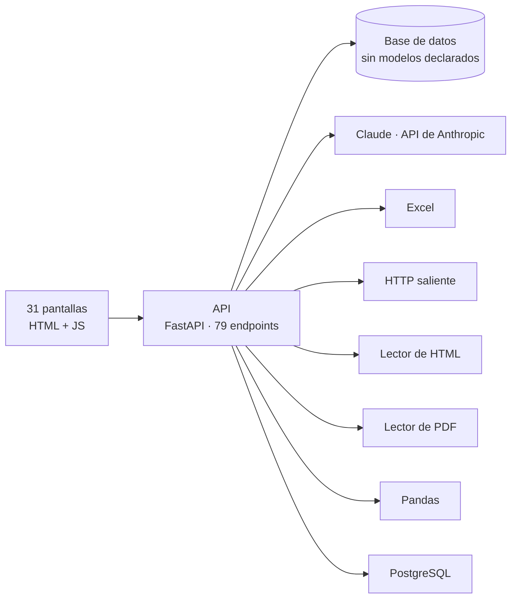

# Arquitectura · AutoRTV

Generado leyendo el repo. **No editar a mano**: lo regenera el CI en cada commit.

Todo lo que figura acá está escrito en el código — dependencias declaradas, decoradores de ruta, `__tablename__` y las rutas que nombran los archivos del front. Nada está inferido por un modelo.

## Las piezas

## Librerías

De dónde sale: la versión, de `requirements*.txt`; el uso, de los `import` de cada archivo. Una librería declarada que nadie importa se nota.

| Librería | Versión | Quién la usa |
|---|---|---|
| `anthropic` | 2.2.0 | `app/agent/cliente.py`, `tests/unit/test_errores.py` |
| `beautifulsoup4` | 4.12.3 | `app/inputs/html.py` |
| `defusedxml` | 0.7.1 | `app/caja/datos.py`, `app/inputs/word.py`, `app/inputs/xml.py` |
| `fastapi` | 0.161.1 | `app/api/rutas.py`, `app/auth.py`, `app/main.py`, `tests/conftest.py` y 6 más |
| `httpx` | sin fijar | `app/web.py`, `tests/unit/test_errores.py` |
| `openpyxl` | sin fijar | `app/export.py`, `app/inputs/cuadricula.py`, `app/inputs/excel.py`, `tests/e2e/test_web_nueva.py` y 7 más |
| `pandas` | 3.1.0 | `app/agent/asistente.py`, `app/agent/banco.py`, `app/agent/controles.py`, `app/agent/diagnostico.py` y 61 más |
| `pdfplumber` | 0.11.4 | `app/agent/diagnostico.py`, `app/agent/lectura.py`, `app/caja/datos.py`, `app/inputs/pdf.py` |
| `playwright` | sin fijar | sin import directo |
| `psycopg` | 3.3.6 | sin import directo |
| `pydantic` | 2.14.1 | `app/acciones.py`, `app/agent/asistente.py`, `app/agent/lectura.py`, `app/agent/senal.py` y 7 más |
| `pytest` | sin fijar | `tests/conftest.py`, `tests/e2e/conftest.py`, `tests/e2e/test_web_nueva.py`, `tests/golden/test_concert.py` y 16 más |
| `python-multipart` | sin fijar | sin import directo |
| `sqlalchemy` | 2.1.6 | `app/acciones.py`, `app/agent/uso.py`, `app/almacen.py`, `app/armados.py` y 14 más |
| `tzdata` | 2025.2 | sin import directo |
| `uvicorn` | sin fijar | sin import directo |
| `xlrd` | 2.0.2 | `app/inputs/cuadricula.py` |
| `xlwt` | sin fijar | sin import directo |

<b>Desglose por pantalla</b> — endpoints y tablas, uno por uno

### index.html

- Endpoints que usa: **0**
- Tablas que tocan esos endpoints: —

### App.tsx

- Endpoints que usa: **4**
- Tablas que tocan esos endpoints: —

| Método | Endpoint | Función | Tablas |
|---|---|---|---|
| GET | `/api/inicio` | `inicio` | — |
| POST | `/api/login` | `login` | — |
| POST | `/api/logout` | `logout` | — |
| GET | `/api/yo` | `yo` | — |

### api.ts

- Endpoints que usa: **79**
- Tablas que tocan esos endpoints: —

| Método | Endpoint | Función | Tablas |
|---|---|---|---|
| POST | `/api/admin/acciones` | `aplicar_acciones` | — |
| GET | `/api/admin/avisos` | `listar_avisos` | — |
| POST | `/api/admin/avisos/{aviso_id}/visto` | `aviso_visto` | — |
| POST | `/api/admin/banco` | `lanzar_banco` | — |
| GET | `/api/admin/banco` | `corridas_del_banco` | — |
| GET | `/api/admin/banco/senales` | `senales_para_banco` | — |
| GET | `/api/admin/banco/{corrida_id}` | `corrida_del_banco` | — |
| POST | `/api/admin/banco/{corrida_id}/aplicar` | `aplicar_del_banco` | — |
| GET | `/api/admin/caja` | `estado_de_la_caja` | — |
| POST | `/api/admin/caja/probar` | `probar_la_caja` | — |
| GET | `/api/agente/conversaciones` | `mis_conversaciones` | — |
| GET | `/api/agente/conversaciones/{conversacion_id}` | `una_conversacion` | — |
| DELETE | `/api/agente/conversaciones/{conversacion_id}` | `borrar_conversacion` | — |
| POST | `/api/agente/mensajes` | `guardar_mensaje` | — |
| POST | `/api/asistente` | `asistente` | — |
| POST | `/api/asistente/charla` | `charla_asistente` | — |
| GET | `/api/asistente/limites` | `limites_asistente` | — |
| GET | `/api/asistente/uso` | `uso_asistente` | — |
| GET | `/api/catalogo` | `ver_catalogo` | — |
| POST | `/api/catalogo` | `cargar_catalogo` | — |
| POST | `/api/export` | `exportar` | — |
| GET | `/api/historial` | `ver_historial` | — |
| GET | `/api/historial/{senal_id}` | `detalle_historial` | — |
| GET | `/api/inicio` | `inicio` | — |
| POST | `/api/login` | `login` | — |
| POST | `/api/logout` | `logout` | — |
| POST | `/api/preview` | `preview` | — |
| GET | `/api/senales` | `senales` | — |
| GET | `/api/senales-parecidas` | `ver_parecidas` | — |
| POST | `/api/senales/crear` | `crear_senal` | — |
| GET | `/api/senales/{senal_id}` | `senal` | — |
| PUT | `/api/senales/{senal_id}` | `guardar_senal` | — |
| DELETE | `/api/senales/{senal_id}` | `borrar_senal` | — |
| GET | `/api/senales/{senal_id}/abierta` | `ver_semana_abierta` | — |
| POST | `/api/senales/{senal_id}/abierta` | `abrir_semana` | — |
| DELETE | `/api/senales/{senal_id}/abierta` | `borrar_abierta` | — |
| POST | `/api/senales/{senal_id}/abierta/aceptar` | `aceptar_abierta` | — |
| POST | `/api/senales/{senal_id}/abierta/aplicar` | `aplicar_en_semana` | — |
| POST | `/api/senales/{senal_id}/abierta/arreglo` | `arreglo_rapido` | — |
| POST | `/api/senales/{senal_id}/abierta/celda` | `editar_celda_abierta` | — |

### columnasAjustables.ts

- Endpoints que usa: **0**
- Tablas que tocan esos endpoints: —

### pantallas/Administrar.tsx

- Endpoints que usa: **7**
- Tablas que tocan esos endpoints: —

| Método | Endpoint | Función | Tablas |
|---|---|---|---|
| POST | `/api/admin/acciones` | `aplicar_acciones` | — |
| GET | `/api/admin/avisos` | `listar_avisos` | — |
| GET | `/api/asistente/uso` | `uso_asistente` | — |
| GET | `/api/catalogo` | `ver_catalogo` | — |
| POST | `/api/catalogo` | `cargar_catalogo` | — |
| GET | `/api/usuarios` | `usuarios` | — |
| POST | `/api/usuarios` | `crear_usuario` | — |

### pantallas/Configuracion.tsx

- Endpoints que usa: **1**
- Tablas que tocan esos endpoints: —

| Método | Endpoint | Función | Tablas |
|---|---|---|---|
| POST | `/api/preview` | `preview` | — |

### pantallas/Historial.tsx

- Endpoints que usa: **2**
- Tablas que tocan esos endpoints: —

| Método | Endpoint | Función | Tablas |
|---|---|---|---|
| GET | `/api/usuarios` | `usuarios` | — |
| POST | `/api/usuarios` | `crear_usuario` | — |

### pantallas/Inicio.tsx

- Endpoints que usa: **0**
- Tablas que tocan esos endpoints: —

### pantallas/Login.tsx

- Endpoints que usa: **1**
- Tablas que tocan esos endpoints: —

| Método | Endpoint | Función | Tablas |
|---|---|---|---|
| POST | `/api/login` | `login` | — |

### pantallas/Nueva.tsx

- Endpoints que usa: **4**
- Tablas que tocan esos endpoints: —

| Método | Endpoint | Función | Tablas |
|---|---|---|---|
| POST | `/api/senales/crear` | `crear_senal` | — |
| GET | `/api/senales/{senal_id}` | `senal` | — |
| PUT | `/api/senales/{senal_id}` | `guardar_senal` | — |
| DELETE | `/api/senales/{senal_id}` | `borrar_senal` | — |

### piezas/Agente.tsx

- Endpoints que usa: **5**
- Tablas que tocan esos endpoints: —

| Método | Endpoint | Función | Tablas |
|---|---|---|---|
| GET | `/api/agente/conversaciones` | `mis_conversaciones` | — |
| POST | `/api/agente/mensajes` | `guardar_mensaje` | — |
| POST | `/api/asistente` | `asistente` | — |
| POST | `/api/asistente/charla` | `charla_asistente` | — |
| GET | `/api/asistente/limites` | `limites_asistente` | — |

### piezas/BancoAgentes.tsx

- Endpoints que usa: **4**
- Tablas que tocan esos endpoints: —

| Método | Endpoint | Función | Tablas |
|---|---|---|---|
| POST | `/api/admin/banco` | `lanzar_banco` | — |
| GET | `/api/admin/banco` | `corridas_del_banco` | — |
| GET | `/api/admin/banco/senales` | `senales_para_banco` | — |
| GET | `/api/admin/banco/{corrida_id}` | `corrida_del_banco` | — |

### piezas/Barra.tsx

- Endpoints que usa: **11**
- Tablas que tocan esos endpoints: —

| Método | Endpoint | Función | Tablas |
|---|---|---|---|
| POST | `/api/admin/acciones` | `aplicar_acciones` | — |
| GET | `/api/admin/avisos` | `listar_avisos` | — |
| POST | `/api/admin/avisos/{aviso_id}/visto` | `aviso_visto` | — |
| POST | `/api/admin/banco` | `lanzar_banco` | — |
| GET | `/api/admin/banco` | `corridas_del_banco` | — |
| GET | `/api/admin/banco/senales` | `senales_para_banco` | — |
| GET | `/api/admin/banco/{corrida_id}` | `corrida_del_banco` | — |
| POST | `/api/admin/banco/{corrida_id}/aplicar` | `aplicar_del_banco` | — |
| GET | `/api/admin/caja` | `estado_de_la_caja` | — |
| POST | `/api/admin/caja/probar` | `probar_la_caja` | — |
| GET | `/api/historial` | `ver_historial` | — |

### piezas/CajaCodigo.tsx

- Endpoints que usa: **2**
- Tablas que tocan esos endpoints: —

| Método | Endpoint | Función | Tablas |
|---|---|---|---|
| GET | `/api/admin/caja` | `estado_de_la_caja` | — |
| POST | `/api/admin/caja/probar` | `probar_la_caja` | — |

### piezas/CambiarClave.tsx

- Endpoints que usa: **1**
- Tablas que tocan esos endpoints: —

| Método | Endpoint | Función | Tablas |
|---|---|---|---|
| POST | `/api/yo/clave` | `cambiar_mi_clave` | — |

### ruta.ts

- Endpoints que usa: **12**
- Tablas que tocan esos endpoints: —

| Método | Endpoint | Función | Tablas |
|---|---|---|---|
| POST | `/api/admin/acciones` | `aplicar_acciones` | — |
| GET | `/api/admin/avisos` | `listar_avisos` | — |
| POST | `/api/admin/avisos/{aviso_id}/visto` | `aviso_visto` | — |
| POST | `/api/admin/banco` | `lanzar_banco` | — |
| GET | `/api/admin/banco` | `corridas_del_banco` | — |
| GET | `/api/admin/banco/senales` | `senales_para_banco` | — |
| GET | `/api/admin/banco/{corrida_id}` | `corrida_del_banco` | — |
| POST | `/api/admin/banco/{corrida_id}/aplicar` | `aplicar_del_banco` | — |
| GET | `/api/admin/caja` | `estado_de_la_caja` | — |
| POST | `/api/admin/caja/probar` | `probar_la_caja` | — |
| GET | `/api/historial` | `ver_historial` | — |
| POST | `/api/login` | `login` | — |

### vite.config.ts

- Endpoints que usa: **79**
- Tablas que tocan esos endpoints: —

| Método | Endpoint | Función | Tablas |
|---|---|---|---|
| POST | `/api/admin/acciones` | `aplicar_acciones` | — |
| GET | `/api/admin/avisos` | `listar_avisos` | — |
| POST | `/api/admin/avisos/{aviso_id}/visto` | `aviso_visto` | — |
| POST | `/api/admin/banco` | `lanzar_banco` | — |
| GET | `/api/admin/banco` | `corridas_del_banco` | — |
| GET | `/api/admin/banco/senales` | `senales_para_banco` | — |
| GET | `/api/admin/banco/{corrida_id}` | `corrida_del_banco` | — |
| POST | `/api/admin/banco/{corrida_id}/aplicar` | `aplicar_del_banco` | — |
| GET | `/api/admin/caja` | `estado_de_la_caja` | — |
| POST | `/api/admin/caja/probar` | `probar_la_caja` | — |
| GET | `/api/agente/conversaciones` | `mis_conversaciones` | — |
| GET | `/api/agente/conversaciones/{conversacion_id}` | `una_conversacion` | — |
| DELETE | `/api/agente/conversaciones/{conversacion_id}` | `borrar_conversacion` | — |
| POST | `/api/agente/mensajes` | `guardar_mensaje` | — |
| POST | `/api/asistente` | `asistente` | — |
| POST | `/api/asistente/charla` | `charla_asistente` | — |
| GET | `/api/asistente/limites` | `limites_asistente` | — |
| GET | `/api/asistente/uso` | `uso_asistente` | — |
| GET | `/api/catalogo` | `ver_catalogo` | — |
| POST | `/api/catalogo` | `cargar_catalogo` | — |
| POST | `/api/export` | `exportar` | — |
| GET | `/api/historial` | `ver_historial` | — |
| GET | `/api/historial/{senal_id}` | `detalle_historial` | — |
| GET | `/api/inicio` | `inicio` | — |
| POST | `/api/login` | `login` | — |
| POST | `/api/logout` | `logout` | — |
| POST | `/api/preview` | `preview` | — |
| GET | `/api/senales` | `senales` | — |
| GET | `/api/senales-parecidas` | `ver_parecidas` | — |
| POST | `/api/senales/crear` | `crear_senal` | — |
| GET | `/api/senales/{senal_id}` | `senal` | — |
| PUT | `/api/senales/{senal_id}` | `guardar_senal` | — |
| DELETE | `/api/senales/{senal_id}` | `borrar_senal` | — |
| GET | `/api/senales/{senal_id}/abierta` | `ver_semana_abierta` | — |
| POST | `/api/senales/{senal_id}/abierta` | `abrir_semana` | — |
| DELETE | `/api/senales/{senal_id}/abierta` | `borrar_abierta` | — |
| POST | `/api/senales/{senal_id}/abierta/aceptar` | `aceptar_abierta` | — |
| POST | `/api/senales/{senal_id}/abierta/aplicar` | `aplicar_en_semana` | — |
| POST | `/api/senales/{senal_id}/abierta/arreglo` | `arreglo_rapido` | — |
| POST | `/api/senales/{senal_id}/abierta/celda` | `editar_celda_abierta` | — |

## Lo que no se pudo probar

- Endpoints que ninguna pantalla nombra: **0**. Pueden ser internos, llamarse con la ruta armada en tiempo de ejecución, o estar muertos.
- Ningún modelo declara `__tablename__`, así que no se puede saber qué tablas toca cada endpoint. Si las consultas van en SQL suelto, el dato está pero no de una forma que se extraiga sin adivinar.
